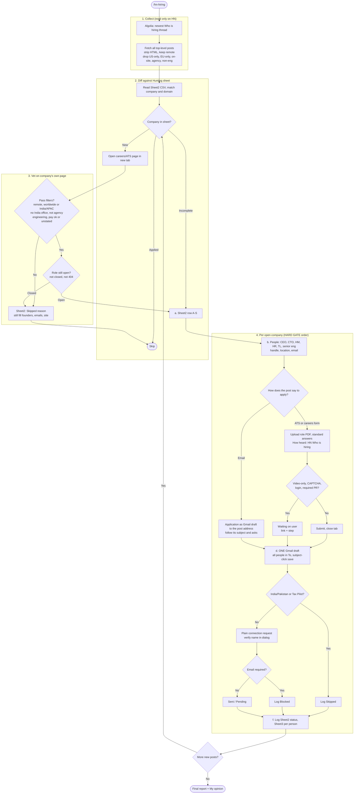

# HN Jobs Flow (skill: `/hn-hiring`)

Source skill: `.claude/commands/hn-hiring.md` (same layout as `/yc-jobs`). This file is the readable copy plus the flow diagram.

Start page (read only): https://news.ycombinator.com/submitted?id=whoishiring

## Diagram v2: end-to-end flow

## Rules in one place
- Diff every post against Sheet2 first; only new posts and incomplete rows get work.
- Vet on the company's own page; no pay stated is not a drop; closed, city-bound, India office, agency, non-engineering are.
- Apply by the channel the post names: ATS form, or email (draft to the post's address). Stops: video-only, CAPTCHA, login, required PR.
- One Gmail draft, plain LinkedIn requests, Sheet2 A-S and Sheet3 rows. One company at a time.

## Columns, LinkedIn and email (v3)
- **Sheet2 A to S** each have a defined meaning in the skill (section 3b): A link, B/C/D emails, E people with LinkedIn, F company LinkedIn, G open source, H website, I careers link, J LinkedIn status, K response, L follow-up count, M follow-up date, N added by, O status, P email sent, Q email failed, R stage, S stage date. Sheet3 has A to F per person.
- **LinkedIn (4c):** follow the company page, request CEO/CTO/hiring manager/team lead/senior engineer plainly (note only if LinkedIn still offers one), comment on a quiet post, mark email-required invites `Blocked`, verify in the sent list.
- **Email (4d):** one draft per company, everyone in To; open compose by navigation, screenshot first, check Drafts rose and Sent did not.
- **Bot-check gates (4e):** typed-phrase and CAPTCHA steps are the user's; log Applied only after the confirmation page.

## Change log
- v3 (2026-11-08): all Hunting sheet columns defined, LinkedIn outreach steps, email safety rules, bot-check gates.
- v1 (2026-11-07): flow for leads with no pay stated.
- v2 (2026-11-08): restructured like yc-jobs (collect, diff, vet, per-company gate, daily refresh); added the closed-role check and the email-apply branch.
