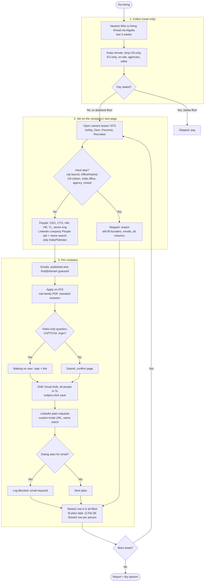

# HN Jobs Flow (skill: `/hn-hiring`)

Source skill: `.claude/commands/hn-hiring.md` (section 6 holds this flow). This file is the readable copy plus the diagram. Keep both in sync.

Start: newest "Ask HN: Who is hiring?" thread (https://news.ycombinator.com/submitted?id=whoishiring), read via the Algolia API (`hn.algolia.com/api/v1/items/<thread id>`). Read only on HN.

## Diagram

PNG: `hn-jobs-flow.png`.

## Rules in one place
- **No pay stated is not a reason to drop.** Apply, draft, reach people on LinkedIn, log the sheet row with every column, record every persona. Pay shown below the floor (~$35k top) still fails.
- **Vet on the company's own page.** HN says "remote" but the ATS may say Office/Hybrid or city-bound (Namespace, Rootly were skipped for that). Hard stops: city-bound or hybrid-only, US-citizen/work-authorization, India office, agency, closed role. Log `Skipped: <reason>` and still fill founders, emails, website, careers link.
- **Apply** on the company ATS (Personio, Ashby, Recruitee, Gem, Greenhouse, Lever) with the matching role-family PDF; standard answers ($60,000 USD, available to start soon, Maharashtra/Mumbai); free text written myself, truthful, no numbers, gaps are "ramping up". Only a video-only question, CAPTCHA or login stops it (`Waiting on user`).
- **People:** CEO/founders, CTO, hiring manager, HR/recruiter, team lead, senior engineer, from the LinkedIn company People tab and name searches. Skip India/Pakistan. Emails published first, else `first@domain` (guessed).
- **One Gmail draft per company**, everyone in To, subject `<Role> - <Company> | Rahul Jha, Atlassian engineer`, saved by clicking the subject, typing one space and waiting 20 s. Never near Send.
- **LinkedIn:** plain request through the custom-invite URL with a dialog name check; "email required" is logged as Blocked.
- **Sheet:** Sheet2 columns A to S all filled (M is a plain date, Q is the FALSE checkbox), Sheet3 one row per person.

## First run (2026-11-07, November 2026 thread)
Eventfirst (applied, Personio), NetBird (applied, Ashby), Tether (waiting on a video answer), Eleshop (email-to-apply draft), Namespace and Rootly (skipped: not remote).

---
## Change log
- v1 (2026-11-07): HN flow for leads with no pay stated.
