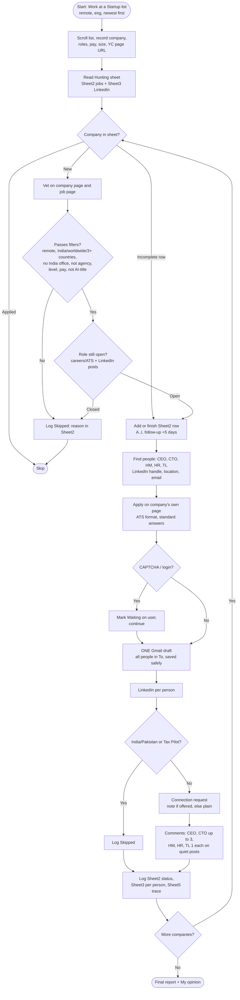
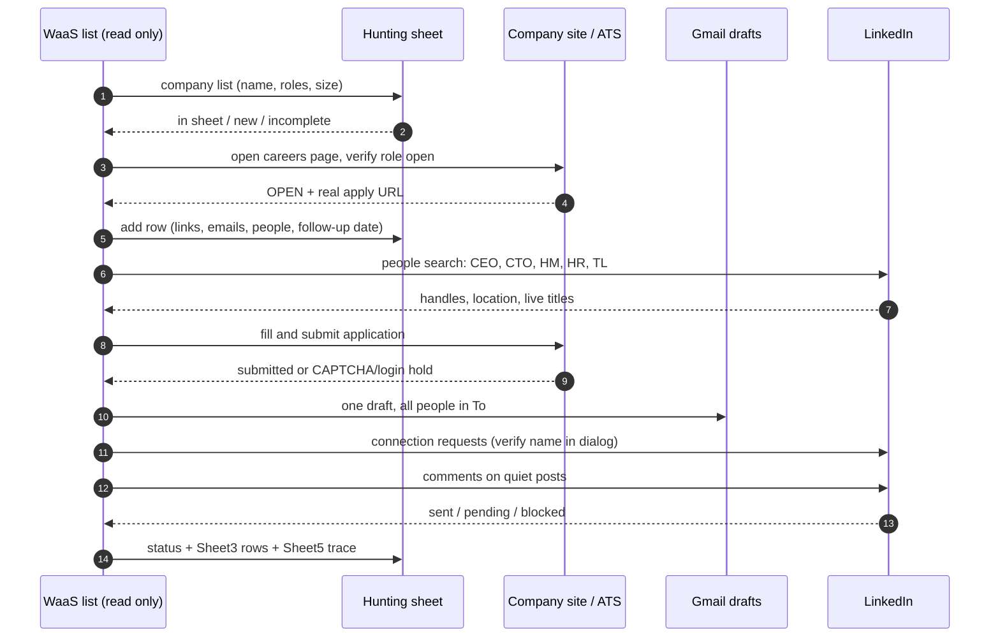
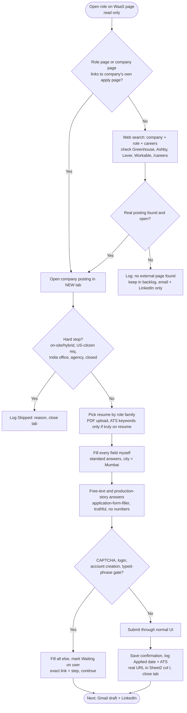

# YC Jobs Flow (skill: `/yc-jobs`)

Source skill: `.claude/commands/yc-jobs.md`. This file is the readable copy plus the flow diagram. Keep both in sync; add new diagram versions below as the flow changes.

Start page (read only, never Apply or message there):
https://www.workatastartup.com/companies?demographic=any&hasEquity=any&hasSalary=any&industry=any&interviewProcess=any&layout=list-compact&remote=only&role=eng&sortBy=created_desc&tab=any&usVisaNotRequired=any

## Diagram v1: end-to-end flow

## Diagram v1: per-company sequence

## Skill text

# YC job flow

Read `CLAUDE.md` first (it holds every rule; this skill only sequences them).

### 1. Collect the list
Open the start page in the Claude tab group, scroll until the list stops growing. Record name, batch, size, location line, roles, pay, company page URL. The `remote=only` filter is unreliable, so every card is vetted on its job page.

### 2. Diff against the Hunting sheet
Read Sheet2 (gid 1578269214) and Sheet3 (gid 954465790) as gviz CSV. Match by company name and domain. Buckets: already in sheet (finish incomplete ones, skip Applied), new. State the counts first.

### 3. Vet each new company, one at a time
Pass: remote and open to India/worldwide/Asia or 3+ countries, US hours OK, no India office, not an agency, engineering role (Staff/Senior/Lead/Founding/MTS first, others at 30%+ match), pay top at or above about $35k, size cap lifted (log size), no AI-engineer titles for now. Reject: US-only residency, on-site/hybrid, US-citizen requirement, India-based. Log rejects as `Skipped: <reason>`. Verify the role is still open on the company careers/ATS page and LinkedIn company posts (never LinkedIn Jobs).

### 4. Per open company, in order
- a. Sheet2 row (Added By `yc-jobs`, status `Found`), read the header first.
- b. People: CEO/founders, CTO, HM, HR, TL with name, role, handle, live title, location, email.
- c. Apply on the company's own page: `application-form-filler`, ATS format, matching resume, standard answers ($60,000 USD, "available to start soon", Maharashtra, India; city fields Mumbai). Free-text answers written by me, truthful, no numbers, no India/country talk. Stop only for CAPTCHA/login/account creation and mark `Waiting on user`.
- d. ONE Gmail draft, everyone in To, never Cc, saved by the approved method (subject click, one space, wait 20 s). Never near Send.
- e. LinkedIn for CEO, CTO, HM, HR, TL (skip India/Pakistan, Tax Pilot): note if offered, else plain request. CEO and CTO get up to 3 job comments, others 1 each, on quiet posts (30 or fewer reactions+comments, else the quietest). Verify the dialog name, then confirm in the Sent invitations list.
- f. Log: Sheet2 `Applied <date> (<ATS>) + drafted`, Sheet3 row per person, Sheet5 trace.

### 5. Rules of the run
One company at a time, no parallel agents, browser only, no new files without approval. Never stop between companies; block-and-continue on anything with no tool path. A typed comment is not posted until the blue Comment button is clicked, so verify the comment count rose.

### 6. Final report (once)
Seen, in sheet, new, rejected with reasons, applied, drafted, LinkedIn requests (sent/pending/blocked), comments (done/left), HOLD list with exact user steps, then "My opinion:".

## Diagram v2: external company website application (step c in detail)

## Applying rules (external company website / ATS)

Where to apply
- Apply ONLY on the company's own page or ATS (Greenhouse, Ashby, Lever, Workable, company /careers). NEVER click Apply or message on workatastartup.com; never use LinkedIn Jobs/Easy Apply.
- Golden rule: if the post links to, or a web search finds, the company's own page, apply there. Never drop a job because the board's Apply is paywalled or hidden.
- Open the posting in a new tab, confirm it is still open, close the tab when done.

Hard stops (log `Skipped: <reason>`, do not apply)
- On-site or hybrid-only; explicit US citizenship/work-authorization or "must reside in the US"; India-based company or India office; agency/marketplace; closed role (404 or "no longer available").
- NOT stops: US-hours overlap, company size (cap lifted, log size), India not listed when 3+ countries, 10+ years asked, 30-40% stack match, AI-engineer titles are only deferred (backlog).

Resume and ATS format
- Upload the PDF for the closest role family (Infra, Full Stack, AI Engineer, Data Scientist), never `.tex`. Full Stack PDF is stale until recompiled in Overleaf.
- Use the posting's exact keywords only where the resume truly supports them; gaps are "ramping up", never added. Plain-text fields, no tables.

Standard answers
- Name Rahul Jha; email <EMAIL>; LinkedIn linkedin.com/in/rahul-jha98; GitHub github.com/rahul-jha98.
- Phone <PHONE> only if required. Salary $60,000 USD. Notice "available to start soon". Location Maharashtra, India (city field: pick Mumbai). Not authorized to work in the US; no sponsorship needed for remote work.
- Never volunteer India, countries or eligibility; only answer if asked.

Free-text answers (`skills/application-form-filler`)
- I write every answer myself, truthful, no invented employers, titles, tools or numbers (numbers only if the form asks for a measurable result, resume-backed).
- "Built in production": Full Stack/backend lead with Kipps.AI portal, Context.dev services, Lokuma MCP layer, then Atlassian; ML/AI lead with the CIKM 2023 paper then applied ML; Infra lead with Atlassian Kubernetes/Terraform/ArgoCD/OTel, then part-time services. Lawflow, SkateYX, Right by Hand only after the user confirms spellings and facts.
- A technology asked: "yes" where real or adjacent experience exists, otherwise "ramping up" with the closest real work.

Never stop, but never bypass
- Fill and submit without asking. The only things left to the user: CAPTCHA, "I am not a robot" or typed-phrase gate, password/login, account creation, age/first language/demographic/visa conflicts, salary history. Mark `Waiting on user: <what> at <site>` with the exact link and move on.

After submit
- Sheet2: status `Applied <date> (<ATS>) + drafted`, real URL in column I, follow-up +5 days. Then the one Gmail draft and LinkedIn step; an application is not done until both are logged or marked HOLD.

---
## Change log
- v1 (2026-11-07): first flow diagram, sequence diagram and skill text.
- v2 (2026-11-07): external company website application flow and applying rules.
